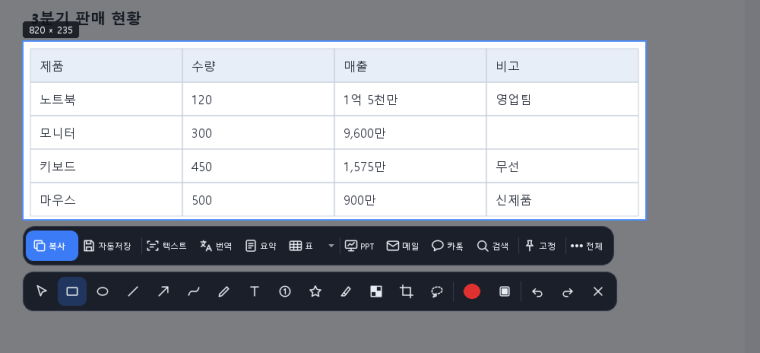
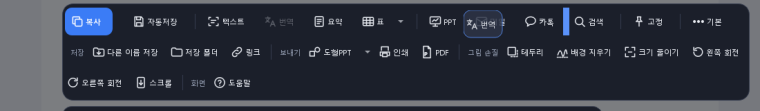
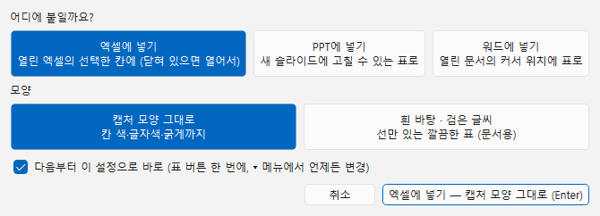
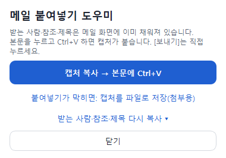
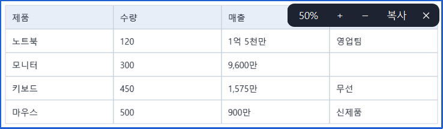
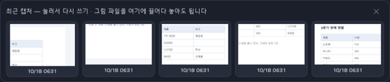

# 캡처 도구 — 처음 쓰는 분을 위한 따라하기

앱 안에서도 같은 내용을 볼 수 있습니다: 캡처 중 **F1**, 버튼 막대의 **전체 → 도움말**, 트레이 메뉴의 **사용 설명서**. 더 자세한 내용은 [USER_GUIDE.md](USER_GUIDE.md)를 보세요.

## 1. 캡처하기 — Alt + ~

화면의 원하는 부분을 찍어 바로 붙여 넣는 기본 사용법입니다.

1. 키보드에서 **Alt** 를 누른 채 **~** (숫자 1 왼쪽 키)를 누릅니다. 화면이 살짝 어두워지고 마우스가 **십자 + 작은 네모** 모양이 됩니다.
2. 찍고 싶은 곳을 마우스로 **끌어서** 네모를 그립니다. 창 하나를 통째로 찍으려면 그 창의 **제목 줄을 한 번 클릭**하세요.
3. 다 그리면 **그 순간 복사**됩니다. 카카오톡·메일·문서에 가서 **Ctrl + V** 하면 붙습니다.
4. 취소하려면 **Esc** 를 누릅니다.

*▲ 표를 골랐을 때: 파란 네모가 고른 곳, 바로 아래가 버튼 막대, 그 아래가 그리기 도구*

> 💡 단축키는 설정에서 바꿀 수 있습니다. 화면 오른쪽 아래 트레이의 캡처 도구 아이콘을 눌러도 시작됩니다.

## 2. 아래 버튼 막대 한눈에

캡처하면 바로 아래에 버튼이 한 줄로 나옵니다.

1. 첫 줄은 **즐겨찾기**: **복사** · 자동저장 · 텍스트 · 번역 · 요약 · 표 · PPT · 메일 · 카톡 · 검색 · 고정 · **전체**.
2. **복사**: 복사하고 캡처 화면을 닫습니다 (Enter, Ctrl+C 도 같음). **자동저장**: 파랗게 눌려 있으면 캡처할 때마다 저장 폴더에 파일로도 저장됩니다.
3. **텍스트** · **번역** · **요약** · **표**: 그림 속 글자·표를 읽어 씁니다. **PPT** · **메일** · **카톡** · **검색**: 보냅니다. **고정**: 화면 위에 띄워 둡니다.
4. **전체**를 누르면 나머지 버튼이 **비슷한 것끼리 묶여** 둘째 줄에 나옵니다: 저장(다른 이름 저장 · 저장 폴더 · 링크), 보내기(도형PPT · 인쇄 · PDF),
5. 그림 손질(테두리 · 배경 지우기 · 크기 줄이기 · 왼쪽 회전 · 오른쪽 회전 · 스크롤), 화면(도움말). 다시 누르면 접힙니다.
6. 버튼을 **누른 채 끌면** 자리를 옮깁니다: 원래 자리는 흐려지고 놓일 자리에 **파란 선**이 보입니다. 놓으면 그 자리로 가고 바로 저장됩니다.
7. 전체 줄의 버튼을 **첫 줄로 끌어 올리면** 즐겨찾기에 들어가고, 첫 줄 버튼을 **전체 줄로 끌어내리면** 빠져서 제 그룹으로 돌아갑니다. 막대 밖에서 놓으면 취소. 복사·전체는 자리가 고정입니다.
8. 버튼을 **오른쪽 클릭**해도 됩니다: **즐겨찾기에 넣기·빼기, 왼쪽·오른쪽으로, 이 장소에서 숨기기**. 내 식대로 줄을 꾸미세요.
9. **집 / 회사**: 트레이 메뉴 **지금 장소**에서 바꾸면 장소마다 다른 배치를 씁니다. 회사에서는 메일·카톡이 기본으로 숨겨지고 막대 끝에 **회사** 표시가 붙습니다.

*▲ 전체를 펼친 모습. 번역을 누른 채 끄는 중: 원래 자리는 흐리고, 파란 선이 놓일 자리*

> 💡 버튼 위에 마우스를 잠시 올리면 설명이 나옵니다. 설정 → 버튼 막대에서도 배치를 바꿉니다 (목록도 끌어서 순서 변경).

## 3. 그림 그리기 · 글자 넣기

붙이기 전에 표시를 하고 싶을 때.

1. 캡처 아래의 그리기 도구에서 **네모 · 원 · 화살표 · 펜 · 글자(T) · 번호 · 형광펜 · 모자이크** 중 하나를 고릅니다.
2. 캡처 위에서 끌어서 그립니다. 색과 굵기는 도구 막대 오른쪽에서 바꿉니다.
3. 그린 것을 **두 번 클릭**하면 선택되어 끌어서 옮기고 색·굵기를 바꿀 수 있습니다(Delete 삭제). 글자는 두 번 클릭해 다시 고칩니다.
4. **기호**(S): 별·체크·화살표·번호 같은 기호를 고르고 클릭한 자리에 찍습니다. 누른 채 끌면 그대로 옮겨지고, 두 번 클릭하면 다시 옮기고 색·크기를 바꿉니다.
5. 잘못 그렸으면 **Ctrl + Z** (되돌리기). 그린 것도 클립보드 복사본에 같이 들어갑니다.

## 3-1. 자르기 (필요한 부분만 남기기)

캡처하거나 스크롤로 길게 찍은 뒤, 필요한 부분만 남깁니다.

1. 그리기 도구 줄의 **자르기** (단축키 **X**)를 누릅니다.
2. 남길 부분을 **네모로 끕니다**. 바깥은 어둡게 보이고, 복사·저장·PPT·메일에는 그 부분만 들어갑니다.
3. 다시 끌면 새 네모로 바뀌고, **Ctrl+Z** 로 원래대로 돌아갑니다.
4. 스크롤 캡처처럼 긴 그림은 편집 창의 **축소 -** / **폭 맞춤** 으로 전체가 보이게 한 뒤 끌면 편합니다.
5. 모양대로 오리려면 **자유형 자르기** (K)로 테두리를 따라 그립니다.

> 💡 자른 뒤 텍스트·표·도형PPT도 남긴 부분만 읽습니다.

## 4. 표를 엑셀·PPT·워드로

화면의 표(엑셀, 웹 페이지, 어두운 화면의 표도)를 고칠 수 있는 진짜 표로 옮깁니다.

1. 표가 보이게 캡처하고 **표** 버튼을 누릅니다. 아래에 "표를 읽는 중"이 뜨고 1~2초 뒤 결과가 나옵니다.
2. 처음에는 **어디에 붙일지**(엑셀에 넣기 / PPT에 넣기 / 워드에 넣기)와 **모양**(캡처 모양 그대로 / 흰 바탕·검은 글씨)을 고릅니다.
3. 엑셀이 열려 있으면 **선택한 칸에**, 닫혀 있으면 **엑셀을 열어 새 문서에** 바로 붙습니다. PPT·워드도 바로 들어갑니다.
4. 보내고 나면 캡처 화면이 닫히고 엑셀·PPT·워드가 앞에 보입니다. 터미널처럼 선 문자로 그린 표, 줄바꿈된 칸도 됩니다.
5. 표 모양이 아닌 글이면 **미리보기**가 떠서, 칸을 나누는 방법(세로선 | · 쉼표 · 띄어쓰기/탭 · "항목: 값" · 직접 입력)을 고르고 칸을 고친 뒤 붙일 수 있습니다.
6. `|열 | 제목 | 내용|` 처럼 기호로 구분된 글자 표는 엑셀의 텍스트 나누기처럼 바로 칸이 나뉩니다. `---` 줄은 구분선으로 보고 뺍니다.
7. 나중에 바꾸려면 **표** 버튼 옆 **▾** 를 누르세요.

*▲ 처음 표 버튼을 누르면 나오는 창: 붙일 곳과 모양을 고릅니다*

> 💡 "다음부터 이 설정으로 바로"를 켜 두면 표 버튼 한 번에 끝납니다.

## 5. 글자 복사 · 번역 · 요약

그림 속 글자를 글로 옮기고, 번역하거나 요약합니다.

1. 캡처하고 **텍스트** 를 누르면 글자가 바로 복사됩니다.
2. 일부만 필요하면 그 글자 위를 **끌어서** 고르면 그 부분만 복사됩니다. **Esc** 한 번이면 캡처가 닫힙니다.
3. **서식 유지** 가 켜져 있으면 글자색·배경색·굵기·들여쓰기까지 함께 복사됩니다. 메모장에는 글자만 붙습니다.
4. 주민번호·전화번호·이메일·카드번호는 **개인정보 자동 가림** 때문에 `*`로 붙습니다(붙인 뒤 알림에 무엇을 가렸는지 나옵니다). 숫자 그대로 쓰려면 텍스트 창의 **개인정보 자동 가림** 체크를 끄세요 — 한 번 끄면 기억됩니다(설정에서도).
5. 휴대폰으로 찍은 **문서 사진**도 읽습니다(자동으로 키우고 선명하게 한 뒤 읽음). 흐리거나 기울어진 사진은 몇 글자가 틀릴 수 있고, 사진 속 표는 선을 못 찾으면 **표** 미리보기에서 나누기 규칙으로 칸을 만듭니다.
6. 엑셀(한 줄에 한 칸)·워드·웹 편집기에는 Ctrl+V, 파워포인트는 **PPT** 버튼을 누르면 같은 모습으로 들어갑니다.
7. Confluence는 정해진 색만 쓸 수 있어, 글자색은 Confluence 색 중 **가장 가까운 색**으로 바뀌어 붙습니다.
8. 버튼 줄의 **번역** 또는 **요약** 을 누르면 결과 창이 뜹니다 — **텍스트를 먼저 누르지 않아도 됩니다.**
9. 일부만 번역·요약하려면 **텍스트** 를 누르고 그 글자를 끌어서 고른 뒤 **번역** · **요약** 을 누릅니다.
10. 결과 창에서 **복사** · **PPT로** · **표로 복사** 를 고릅니다.
11. **줄바꿈 없이** 를 누르면 여러 줄을 한 줄(한 문단)로 이어 붙여 복사합니다.
12. 텍스트를 누른 상태에서 **메일** · **카톡** · **PPT** 를 누르면 그림이 아니라 그 **글자**가 들어갑니다.

> 💡 번역·요약은 기본으로 이 PC 안에서만 처리되어 글이 밖으로 나가지 않습니다.

## 6. 파워포인트로 보내기

1. **PPT** 를 누르면 캡처가 파워포인트의 **새 슬라이드**에 들어가고 파워포인트가 앞으로 나옵니다.
2. **도형PPT** (전체 안)는 캡처 속 상자·화살표·글자를 **고칠 수 있는 도형**으로 바꿔 넣습니다.
3. 글이 여러 줄 든 상자(카드)는 **도형 하나에 글 하나**로, 점선 상자는 점선 도형으로 들어갑니다.
4. **도형PPT 버튼의 ▾** → **글자를 하나의 상자로 합쳐서** 를 고르면 흩어진 글자가 한 개의 텍스트 상자로 들어갑니다(배너·문단).
5. 웹 화면의 입력칸·버튼·체크 상자는 제자리에 도형으로, 표는 **고칠 수 있는 PowerPoint 표**로, 아이콘은 작은 그림으로 들어갑니다.
6. 표 위에 번호·상자 등을 그려 두었다면, 표는 PowerPoint 표로, 그린 표시는 그 위에 같은 자리로 들어갑니다.
7. 파워포인트가 없거나 응답이 없으면 클립보드에 넣어 두니 직접 Ctrl+V 하세요.

> 💡 설정에서 "새 슬라이드에 넣기"를 끄면 보고 있는 슬라이드에 넣습니다.

## 7. 메일로 보내기 (네이버 · Gmail 등)

캡처 도구가 메일을 대신 보내지는 않습니다. 쓰기 화면까지 준비해 주고, 보내기는 직접 누릅니다.

1. 캡처하고 **메일** 을 누릅니다.
2. 받는 사람을 고릅니다: **자주 · 최근 · 그룹 · 전체 주소록** 에서 체크하고, 사람마다 **받는 사람 / 참조** 를 정합니다. 새 주소는 위 칸에 쓰고 Enter.
3. 맨 위 **보낼 메일** 에서 **네이버 메일** 또는 **Gmail** 을 누르고(다른 메일은 옆 목록), **메일 쓰기** 를 누릅니다.
4. 브라우저에 메일 쓰기 화면이 열립니다. 네이버·Gmail은 받는 사람과 제목이 이미 채워져 있습니다.
5. 본문을 누르고 **Ctrl + V** 하면 캡처가 붙습니다. 칸이 비어 있으면 오른쪽 **도우미 창**의 "다시 복사"로 받는 사람·참조·제목을 하나씩 붙일 수 있습니다.
6. 확인하고 메일의 **[보내기]** 를 직접 누릅니다.

*▲ 메일 쓰기 화면 옆에 뜨는 도우미 창: 위에서부터 눌러 차례로 붙여 넣습니다*

> 💡 로그인 화면이 나오면 로그인한 뒤 계속하세요. 주소록은 [주소·그룹 편집]에서 추가·삭제하고, 이 PC에만 암호화되어 저장됩니다.

## 8. 카카오톡으로 보내기

1. 카카오톡에서 보낼 채팅방을 **따로 창으로 열어 둡니다**.
2. 캡처하고 **카톡** 을 누르면 열려 있는 채팅방 목록이 나옵니다. 채팅방을 고르세요.
3. 그 채팅방에 캡처가 붙어 들어가고 카카오톡의 확인 창이 뜹니다. **[전송]** 을 눌러야 보내집니다.

> 💡 채팅방이 목록에 없으면 "카카오톡 열기"를 골라 채팅방에서 Ctrl+V 하세요.

## 9. 검색 (구글 · 네이버)

1. 캡처하고 **검색** 을 누릅니다.
2. **그림으로 찾기**: 구글 렌즈의 **이미지로 검색** 창이 열리고 캡처가 **저절로 붙어** 찾습니다(안 붙으면 그 창에서 **Ctrl + V**). 네이버는 PC에서 그림 검색을 지원하지 않습니다.
3. **글자로 찾기**: 캡처 속 글자를 읽어 구글·네이버 검색이나 파파고 번역을 바로 엽니다.

> 💡 그림은 직접 붙여 넣기 전에는 어디에도 올라가지 않습니다.

## 10. 화면에 고정하기 (여러 장)

자료를 보면서 작업할 때 캡처를 다른 창 위에 띄워 둡니다.

1. 캡처하고 **고정** 을 누른 뒤 띄울 곳을 고릅니다: **찍은 자리 그대로(F3)** · **오른쪽 위에 쌓기** · **다른 모니터로**.
2. 여러 장을 계속 고정할 수 있습니다. 끌어서 옮기고, 마우스 휠로 크기를 바꿉니다.
3. 고정한 그림에 마우스를 올리면 작은 막대가 나옵니다: **50%**(반투명) · **+ / −** · **복사** · **✕**.
4. 여러 장을 한꺼번에 정리하려면 고정 메뉴의 **고정한 캡처 관리** 를 여세요(나란히 · 모두 숨기기 · 모두 닫기).

*▲ 고정한 캡처에 마우스를 올리면 오른쪽 위에 작은 막대가 나옵니다*

## 11. 긴 화면 찍기 (스크롤)

웹 페이지나 PDF처럼 화면보다 긴 내용을 한 장으로 찍습니다.

1. 캡처할 때 브라우저 창의 **제목 줄을 클릭**해 창 전체를 고르거나, 찍을 부분을 네모로 고릅니다.
2. **전체** → **스크롤** 을 누르면 자동으로 아래로 내려가며 찍습니다. 멈추려면 **Esc**.
3. 끝나면 편집 창이 열려 그리기·텍스트·PPT 등을 똑같이 쓸 수 있습니다.

## 12. 저장한 캡처 · 그림 파일 다시 쓰기

다시 캡처하지 않고, 저장해 둔 캡처나 아무 그림 파일을 열어 표·텍스트·PPT·메일 버튼을 그대로 씁니다.

1. **Alt + ~** 로 캡처를 시작하면 아래에 **최근 캡처**(자동저장한 것) 8장이 보입니다. 하나를 누르면 열립니다.
2. 열린 창에서 캡처할 때와 같은 버튼(표·텍스트·도형PPT·메일·고정…)을 씁니다. 다시 저장되지는 않습니다.
3. 다른 그림 파일은 그 줄이나 열린 창에 **끌어다 놓거나**, 파일을 오른쪽 클릭 → **보내기 → 캡처 도구**.
4. 트레이 아이콘 메뉴의 **이미지 열기…** 로 골라도 됩니다. 영역을 고르기 시작하면 최근 캡처 줄은 사라집니다.
5. 열린 창 아래에도 최근 캡처 줄이 있어 다른 캡처로 바로 바꿀 수 있고, 열린 채 **Alt + ~** 를 누르면 창을 닫고 새로 캡처합니다.

*▲ 캡처를 시작하면 나오는 최근 캡처 줄: 눌러서 다시 쓰기*

> 💡 최근 캡처 줄이 필요 없으면 줄 오른쪽 위 ✕ (이번만) 또는 설정에서 끕니다.

## 12-1. 인쇄 · PDF · 크기 줄이기

캡처를 종이로 인쇄하거나 PDF로 저장하고, 파일을 작게 만듭니다. 모두 **전체** 버튼 안에 있습니다.

1. **인쇄**: Windows 인쇄 창이 떠서 프린터·용지를 고릅니다. 그림은 용지에 맞춰 들어갑니다.
2. **PDF**: 캡처를 PDF 파일로 저장합니다. 스크롤 캡처처럼 긴 그림은 여러 쪽으로 나뉩니다(설정에서 한 쪽에 맞추기도 가능).
3. **크기 줄이기**: 긴 쪽 1280px·50%·25%·용량 1MB 등으로 작게 만듭니다. 바뀐 크기와 예상 용량을 미리 보고, 복사·저장이 그 크기로 됩니다.
4. 메일에 첨부하거나 메신저로 보낼 때 용량을 줄이는 데 좋습니다.
5. **왼쪽 회전** · **오른쪽 회전**: 90°씩 돌립니다(옆으로 찍은 사진·세로 문서). 캡처 중이면 편집 창이 열리고, 편집 창에서는 그 자리에서 돌아가 이어서 그립니다.

> 💡 크기 줄이기 창에서 원본과 줄인 결과를 나란히 비교할 수 있습니다.

## 12-2. 테두리 · 음영

캡처 둘레에 테두리와 그림자를 넣어 깔끔하게 만듭니다. **전체 → 테두리** 안에 있습니다.

1. **굵기**: 없음·얇게·보통·두껍게 중에서 고릅니다.
2. **색**: 흰색·검정·회색·파랑·빨강에서 고르거나 **색 선택…** 으로 원하는 색을 지정합니다.
3. **음영(그림자)**: 체크하면 캡처 뒤에 부드러운 그림자가 생겨 떠 있는 느낌이 납니다.
4. 원본과 결과를 미리 보고 **이대로 복사·저장** 하면 그 모양으로 복사됩니다(자동저장이 켜져 있으면 파일로도 저장).

> 💡 문서·슬라이드에 붙일 때 테두리를 넣으면 배경과 구분되어 보기 좋습니다.

## 12-3. 배경 지우기 (사인 · 도장만 남기기)

종이나 화면의 바탕을 지우고 글씨·사인·도장만 투명하게 남깁니다. **전체 → 배경 지우기** 안에 있습니다.

1. 사인·도장이 있는 곳을 캡처합니다. **올가미(K)** 로 그 부분만 따내면 더 깔끔합니다.
2. **지우는 정도**를 조절하고, **남길 것**에서 색별(검정 글씨·빨강 도장 등)로 체크합니다. 결과는 체크무늬 위에 미리 보입니다.
3. **이대로 복사·저장** 하면 투명 PNG로 복사됩니다. PPT·워드·그림판에 Ctrl+V 하면 뒤가 비쳐 보입니다.

> 💡 문서에 서명을 넣거나 도장만 따로 쓸 때 편합니다. 흐린 사진은 지우는 정도를 낮추면 얇은 선이 살아납니다.

## 13. 저장 · 링크 · 설정

1. **전체** → **다른 이름 저장**: 위치를 골라 파일로 저장합니다. **저장 폴더**: 저장된 파일이 있는 폴더를 엽니다.
2. **전체** → **링크**: 저장한 파일의 위치 링크, 또는 정해진 시간 뒤 지워지는 인터넷 공유 링크를 복사합니다.
3. 트레이 아이콘을 오른쪽 클릭 → **설정** 에서 단축키, 저장 폴더, 버튼 막대(즐겨찾기 · 집/회사), 메일, 모양(색·글꼴 그대로) 등을 바꿉니다.

> 💡 이 설명서는 언제든 **전체 → 도움말**, 캡처 중 **F1**, 트레이 메뉴의 **사용 설명서** 로 다시 열 수 있습니다.

## 14. 잘 안 될 때

1. **캡처가 검게 나와요**: 은행·보안 프로그램이 캡처를 막아 둔 창입니다. 그 프로그램의 보안 기능이라 풀 수 없습니다.
2. **붙여넣기가 안 돼요**: 회사 보안 프로그램이 막는 경우가 있습니다. 메일 도우미의 "파일로 저장(첨부용)"이나 **다른 이름 저장** 후 첨부하세요.
3. **글자를 잘못 읽어요**: 작게 찍힌 글자는 틀리기 쉽습니다. 화면을 확대해서 찍으면 정확해집니다.
4. **단축키가 안 먹어요**: 다른 프로그램이 같은 키를 쓰고 있을 수 있습니다. 설정에서 다른 키로 바꾸세요.
