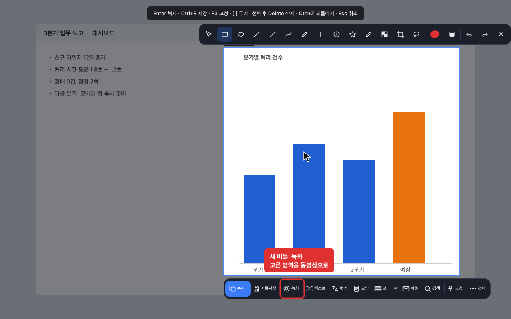
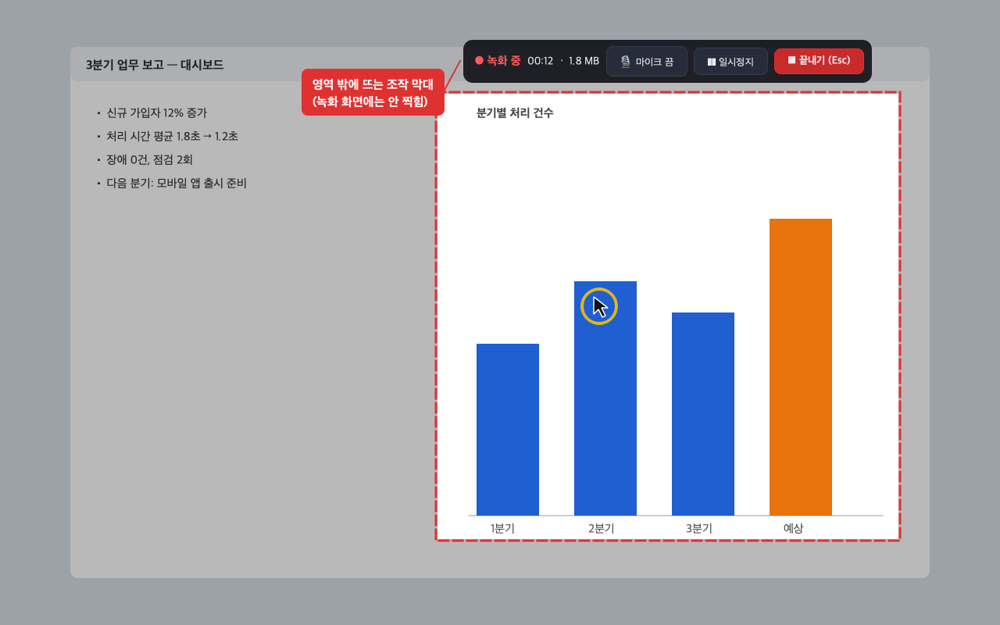
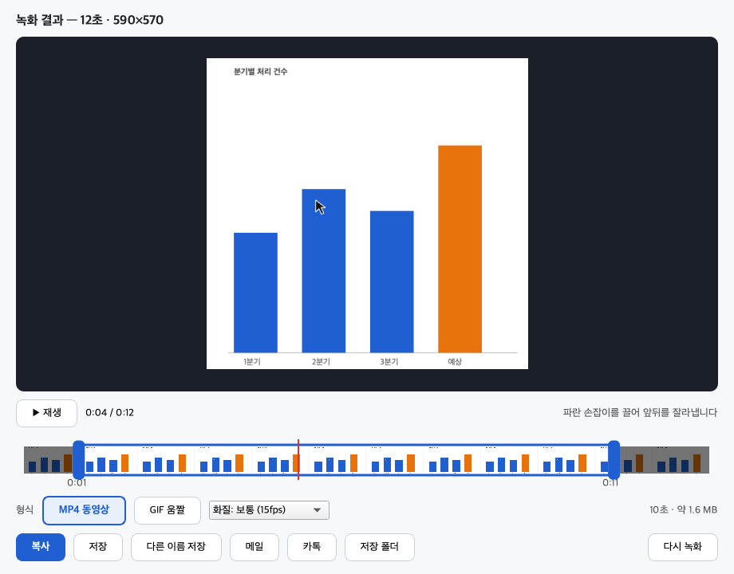
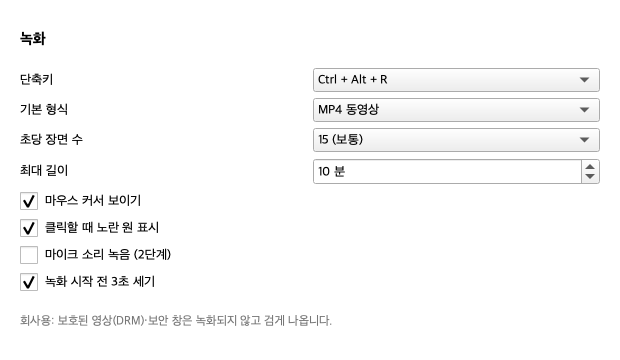

# 화면 녹화 — 제안 (목업 단계, 2026-11-08)

캡처와 같은 방법(Alt + ~ → 영역 고르기)으로 시작해, 고른 영역을 **동영상(MP4) 또는 움짤(GIF)** 로 녹화한다.
쓰임새: 사용법·버그 재현을 보여 주는 짧은 영상, 메신저·메일에 붙이는 움짤.

목업 그림은 앱의 실제 화면 부품(캡처 화면·버튼 막대)을 그대로 그리고, 새 부분만 앱 색으로 덧그렸다
(`make_mockups.py` 와 같은 방식, 앱 코드는 바꾸지 않음).

## 흐름

1. **시작** — Alt + ~ 로 영역을 고른 뒤 버튼 막대의 **녹화**(그림 1). 녹화 전용 단축키(예: Ctrl + Alt + R)는 누르면 바로 영역 고르기.
2. **3초 세기** 뒤 녹화. 영역은 빨간 점선, 영역 밖은 살짝 어둡게. 조작 막대는 영역 **밖**에 뜨고 녹화 화면에는 찍히지 않는다(그림 2).
   - 조작 막대: 녹화 중 표시 · 경과 시간 · 크기 · 마이크(2단계) · 일시정지 · **끝내기(Esc)**
   - 클릭하면 노란 원(설정에서 끄기)
3. **끝내기 / Esc** → 결과 창(그림 3): 미리 보기, 재생, **파란 손잡이로 앞뒤 자르기**, 형식(MP4 / GIF)과 화질, 예상 크기,
   그리고 지금 캡처와 같은 **복사 · 저장 · 다른 이름 저장 · 메일 · 카톡 · 저장 폴더**.
   - 동영상 "복사"는 그림이 아니라 **파일로** 클립보드에 넣는다 — 탐색기·메신저·메일에 붙여 넣으면 파일이 들어간다.
4. **설정**에 녹화 칸(그림 4): 단축키, 기본 형식, 초당 장면 수, 최대 길이, 커서·클릭 표시, 3초 세기.

| 1. 버튼 막대의 새 녹화 버튼 | 2. 녹화 중 |
|---|---|
|  |  |
| **3. 결과 창 (자르기 · 형식 · 보내기)** | **4. 설정의 녹화 칸** |
|  |  |

## 만드는 방법 (기술 방향)

- **화면 받기**: 지금 캡처가 쓰는 화면 받기(Windows: GDI/mss, 맥: Quartz)를 초당 10~30번 반복. 1단계는 영역 녹화만.
  우리 조작 막대·테두리는 녹화에서 빼는 기능이 이미 있다(`exclude_from_capture`, 스크롤 캡처가 사용).
- **MP4 만들기**: FFmpeg 를 감싼 라이브러리(PyAV 또는 imageio-ffmpeg)로 H.264 — 어디서나 재생됨.
  OpenCV 만으로는 H.264 가 안 되어(라이선스) 재생 안 되는 PC가 생김. 설치 파일이 **약 30~60MB 커질 것으로 예상**(확인 필요).
- **GIF 만들기**: 이미 있는 Pillow 로. 크기가 금방 커지므로 짧은 영역·짧은 시간용(결과 창이 예상 크기 표시).
- **소리(2단계)**: 마이크·컴퓨터 소리는 OS마다 방식이 달라(Windows WASAPI, 맥 ScreenCaptureKit) 1단계에서 뺀다.
- **성능 목표**: 1080p 영역 15fps 에서 프레임 누락 없이(누락되면 결과 창에 표시). 메모리에 쌓지 않고 바로 파일로 인코딩.
- **회사용**: 보안 프로그램·보호된 영상(DRM)이 막는 화면은 지금처럼 검게 찍히고 알림. 녹화 중 표시는 항상 보임.

## 단계

- **1단계**: 영역 녹화, 일시정지·끝내기·Esc, 3초 세기, 클릭 표시, 결과 창(재생·앞뒤 자르기·MP4/GIF·복사/저장/메일/카톡), 설정 칸. Windows·맥.
- **2단계**: 마이크·컴퓨터 소리, 창 하나 따라가며 녹화, 전체 화면, 커서 주변 확대, 자른 영상에 그리기·글자.

## 정해야 할 것

1. 1단계에 **소리**를 넣을지 (넣으면 일정이 크게 늘어남 — 제안: 2단계)
2. 기본 형식: **MP4**(제안) 또는 GIF
3. 설치 파일이 30~60MB 커지는 것을 받아들일지 (지금 약 375MB)
4. **회사용**에도 넣을지 (회사 보안 정책 확인 필요)
5. 녹화 단축키 (제안: Ctrl + Alt + R)
